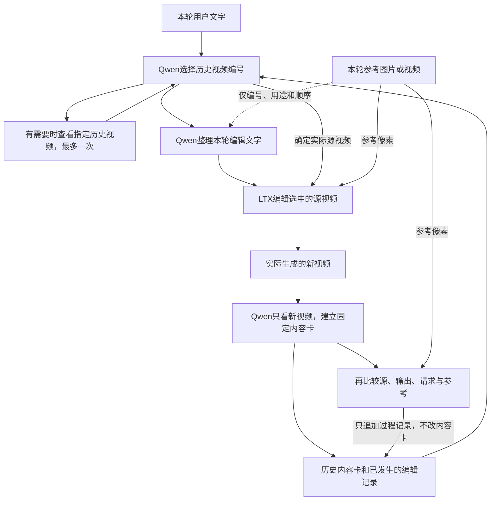

# Qwen＋LTX多轮编辑：第一版实现与评估

**本轮实现与评估已完成。** Qwen不做训练，通过历史记录和工具调用驱动LTX；1000题理解测试及128条完整生成链均已结束，视频、输入来源与记录检查通过。

更新：2026-11-08 11:48 SGT。理解选源正确984/1000；完整生成543轮，选源与原计划一致542/543，保留1次错误回溯。运行成功不等于每次编辑效果都达标。

[查看完整编辑链](formal_v1/closed_loop/report/index.html) · [最终生成统计](analysis/formal_v1_closed_loop_128/README.md) · [逐项完成检查](analysis/completion_audit.md)

## 我们实际实现了什么

Qwen负责理解用户、选择历史版本和整理编辑要求，LTX负责生成视频。Qwen没有微调；我们调整的是提示词、工具接口、记忆文件和运行程序。LTX使用已经训练的LoRA。

现在由**离线批量评估程序**逐轮驱动这些操作，还没有部署可聊天的交互网页。程序虽然持有整条测试链，但每次只把本轮请求和已经发生的历史提供给Qwen，不提前给后续指令或目标视频。现有网页用于查看生成结果。

每轮具体做法：

1. **找起点。** Qwen读历史内容卡和编辑记录，输出实际视频编号，不使用`-1`。明确要求回到某版本时选择该版本；直接继续编辑时选择最新版本。信息不足时可调用`inspect_history`一次，查看最多3个已有视频。本轮编辑参考的像素不进入选源。
2. **整理要求。** 选好视频后，Qwen移除“从第几版开始”等历史选择话语，整理成英文单轮编辑指令，并保留全部参考编号及顺序。本次配置不让它观看编辑参考图片或视频，只提供参考的编号、用途、正背视角等说明。
3. **调用编辑工具。** `edit_video`把实际选中的源视频、整理后的文字和当前参考交给LTX。后续历史使用真正生成的视频，不能用真值替换。
4. **保存两种不同记录。** 先只看新视频建立内容卡，记录画面实际呈现了什么；再由单独的生成后检查比较源视频、输出、用户要求、执行指令和参考，记录改动与问题。比较结果不能回头改写内容卡，避免把“用户想要什么”记成“视频已经有什么”。

工具回答不合要求时允许一次纠正；仍失败就保留失败记录并继续其他案例。不默认改成最新编号，不自动反复生成视频。

这套程序借鉴了Qwen-Agent的工具定义、调用结果反馈和受限工具循环，使用本地Transformers推理与官方聊天/工具模板；**没有部署完整Qwen-Agent框架**。历史编号、文件记忆、LTX适配和生成后检查是本项目的专用实现。[框架与实现范围](README.md#借鉴的框架与范围)

## 本次固定设置

| 项目 | 实际使用 |
|---|---|
| Qwen | 不训练；高档输入；历史视频均匀取16帧，每帧像素上限264192，保持宽高比；确定性解码 |
| LTX | LTX-2.5与已有LoRA；193151训练的最终768步检查点；套装正背分开、镜头首帧、连续时间编码、视觉参考丢弃训练版本 |
| 视频生成 | 40步；文字CFG 3、STG 1、guidance rescale 0.7、参考CFG 1、seed 42 |
| 版本控制 | 开发链验证后冻结463份代码、配置和输入相关文件，正式测试期间不改提示词 |
| 数据隔离 | 开发链来自训练素材分组，正式理解题和生成链来自测试素材分组；按原视频图的连通组隔离 |

[固定配置](formal_v1/frozen_sources/qwen3.8/configs/editing_agent/config.json) · [冻结清单](formal_v1/freeze_manifest.json) · [数据组织与范围](formal_v1/frozen_sources/qwen3.8/datasets/editing_agent_v1/README.md)

另对照了193151及其续训父任务实际保存的训练清单：本轮候选128链和1000题涉及1112个原始、历史及真值视频节点，与LTX训练视频在节点、路径及已记录媒体哈希上均无交集，所属连通组也不重叠。参考资产另算：736个参考中有131个与训练共享，包括衣服、发型、身份和动作等，因此不能把本轮称为“所有参考资产都未见过”的测试。本次依据冻结清单与采样记录核对，没有重新读取全部大型视频。[训练与测试重叠核查](analysis/ltx_training_overlap_audit.md)

## 已完成：1000题理解测试

这部分使用UE合成数据中的真值历史视频，由Qwen自行观察并建立卡片，再选择编辑起点、整理指令；不生成新视频。

| 选择依据 | 正确 / 总数 | 正确率 |
|---|---:|---:|
| 全部题目 | 984 / 1000 | 98.4% |
| 通过画面内容寻找历史 | 484 / 500 | 96.8% |
| 其中：发色 | 245 / 250 | 98.0% |
| 其中：镜头 | 239 / 250 | 95.6% |
| 编号、编辑事件前后、继续或最新版本 | 500 / 500 | 100% |

46题主动查看了历史，共查看115个视频槽位。8次工具回答不合要求，分别是5次选源和3次观察，均在一次纠正后通过。四张H200实际用时**76.59分钟**，包含模型加载和并行执行，来自运行起止时间。

独立流程审查1000/1000通过：核对合法编号、完整参考顺序、选源输入隔离、查看历史的视频，以及3206次历史卡片引用的模型观察来源。这里的“流程通过”不等于答案全对，也不等于每张卡都看对了画面。

16个错题全部是内容选择题，已有逐题文字记录排查及部分候选帧对照。内容选择目前只覆盖发色和镜头；接下来准备编辑的属性虽覆盖七类，也不能据此声称七类视觉历史选择都已经验证。旧测试的输入和题目范围不同，暂不据此宣称相对旧结果的提升。

[完整理解报告](analysis/formal_v1_understanding/final_report.md) · [1000题独立流程审查](analysis/understanding_runtime_audit.md) · [8次纠错证据](analysis/understanding_corrections_audit.json) · [16个错题排查](analysis/understanding_error_review.md)

## 已完成：128条完整生成链、543轮编辑

128条链全部完成，执行失败为0；543轮都已生成视频、独立观察输出并写入历史。后续使用真正生成的视频，包含继续编辑和回溯旧版本。

| 项目 | 最终结果 |
|---|---:|
| 完整链 / 编辑轮次 | 128 / 543 |
| 编辑原视频 / 实际生成历史 | 188 / 355 |
| 首次编辑 / 继续最新版本 / 实际回溯 | 128 / 320 / 95 |
| 选择编号与原计划一致 | 542 / 543 |
| 模型调用 / 不合要求的工具回答 | 2314 / 12 |
| 额外查看历史 | 2次，共5个视频槽位 |

12次工具回答问题中，1次发生在观察原视频时，11次发生在生成后比较；全部一次纠正成功，没有因此重生成视频。最终全量检查核对了实际源视频、参考顺序、独立内容卡和输出媒体，128条全部通过。新增的最后28条没有增加选源差异。

**95次实际回溯中包含1次错误回溯。** `test_chain_13582`第5轮只是要求“当前金发改为黑色”，没有要求选择旧版本，应继续最新视频4；模型查看1/2/3后选择2，实际编辑也从2开始，绕过了第3轮发型和第4轮身份编辑。

这条链第3轮意外把金发改成黑发，第4轮继续保留；最新内容卡的黑发描述与检查的画面一致。后续固定文字仍说“当前金发”，可能诱发模型寻找旧版本，但不能据此改判正确。原始工具输出没有给出思考理由，具体内部原因不能确定。[差异复核及实际帧](analysis/closed_loop_route_disagreements.md)保留了证据。

LTX单轮生成耗时中位数148.15秒，不包含Qwen每轮选择和观察。整个正式评估从02:22到11:45，共约9小时23分钟，包含理解测试、模型加载、四卡到八卡的接续和各档扩展；不是全程八卡用时。八卡任务195434正常结束、退出码0，资源已释放。[作业终态](analysis/formal_v1_closed_loop_128/job_195434_final.txt)与[运行起止记录](formal_v1/campaign.json)可核对。

[最终生成统计](analysis/formal_v1_closed_loop_128/README.md) · [128条全部流程检查](analysis/formal_v1_closed_loop_128/runtime_audit.json) · [工具调用明细](analysis/formal_v1_closed_loop_128/tool_calls/README.md) · [原始记录独立复核](analysis/final_completion_audit.json)

另对前60条链的最后一轮逐条检查了用户原话和实际生成指令，覆盖七类编辑。60条未发现编辑目标或约束被改错，16条历史选择话语被正确移除；参考顺序与实际调用记录也一致。其中仍包含上面的1次选源错误，文字没有改错不能抵消选源错误。这是60个末轮的文字检查，不是全部543轮语义验收，也没有证明改写比原文生成得更好。[逐条文字检查](analysis/generated_prompt_fidelity_60.md)

前60条的实际调用记录显示，Qwen单次选源耗时中位数1.58秒，整理文字5.42秒，独立观察生成视频11.22秒，比较结果11.08秒。LTX视频生成仍占主要耗时。Qwen各次输入最多9804个token，包含文字、工具说明及视觉内容。上述数值来自3–5轮短链，不代表无限增长的历史也有同样成本；也不能将并行调用的耗时直接相加当作整批用时。[输入长度和耗时明细](analysis/formal_v1_closed_loop_60/resource_usage.md)

测试按30→60→100→128扩展，每次只处理新增案例，前面结果保留。[分发检查](analysis/expansion_dispatch_audit.json)和[资源接续审查](analysis/eight_gpu_handoff_audit.md)记录了对应证据。

[整链展示](formal_v1/closed_loop/report/index.html)包括全部128条：一行实际生成链，一行真值对照，标出真实父编号。真值只作离线对照，不回填历史。页面1970处媒体引用均存在，对应1357个普通媒体文件；下载整个`formal_v1/closed_loop/report/`文件夹即可保留相对路径。不要只下载`index.html`。[页面文件检查](analysis/formal_v1_closed_loop_128/gallery_audit.json)

543轮中只有8次基于画面描述寻找历史，其余主要是继续、编号和编辑事件。因此542/543是这批链上的原计划路线一致数，不能写成全面的视觉检索准确率，也不能当作视频编辑成功率。

## 已有14轮固定视觉抽查看到了什么

抽查名单在看效果前固定：按前30条链的原顺序，每种编辑取最早两轮，共七类、14轮，集中在前三条链。不是按效果重新挑选。

实际源视频中5轮来自原始视频，9轮来自生成历史；后9轮均核对了实际源文件与其真正父轮输出的SHA一致。能看到正确改动被继承，也能看到原有瑕疵继续保留：

- `test_chain_12419`第5轮回到第1轮生成结果，恢复早期针织衫和霓虹场景，没有混入后来的西装、桥下场景或行走编辑。
- 场景、发型、服装和取景变化在多例抽帧中可见；两个动作样例在所看时点呈现参考的大致动作阶段。
- 一例白发要求未清楚达成；鞋款、鞋色和花纹有偏差；近景脸和头发的糊块延续到后续编辑；一例换场景后人物过度黄亮。

普通样例查看1/4/8秒；动作样例查看1/2/4/6/8秒；最后一个镜头样例另看0/9秒。**这是静态帧检查，不是完整观看14段视频。** 它不能评价整段闪烁、动作流畅性、相机轨迹或身份替换准确率。输出分辨率也比原始素材低，不能把所有清晰度损失都归于编辑。镜头参考含目标人物画面，接近该参考也不能单独证明源人物信息保持得好。

[固定名单、逐例观察与帧链接](analysis/generated_quality_sample_plan.md) · [实际源与父轮证据](analysis/generated_quality_sample_plan.json) · [抽帧对应关系](analysis/generated_quality_frame_evidence.json)

## 现在可以用于论文讨论的结论

目前已有证据支持：不训练Qwen，通过工具接口和文件记忆可以完成这批题目的历史版本选择；系统已经能够让选中的真实历史驱动单轮编辑，再把实际生成结果保存回历史。生成后的内容描述与任务完成情况分开保存，便于继续回溯和排查问题。

还没有证明以下内容：

- **Prompt enhance确实提高生成质量。** 已检查理解题前20题及60条生成链的末轮文字，但没有同源、同参考、同seed下“原指令／整理后指令”的受控比较。[前20题文字检查](analysis/prompt_fidelity_first20.md) · [60个末轮文字检查](analysis/generated_prompt_fidelity_60.md)
- **各种用户表达都能稳定处理。** 本轮请求来自数据集的英文指令，尚未系统评估中文、口语、省略表达或错别字；不能把规范英文上的结果直接推广过去。
- **完整多轮编辑整体质量已经达标。** 128条虽已运行完成，但固定14轮静态抽查不足以形成总体质量比例。
- **记忆卡、查看历史、独立生成后检查各自带来多少提升。** 尚未完成这些组件的对照实验；Qwen自己的检查不能替代独立质量评价。

本轮交付已完成。下一步与用户讨论论文中的正式指标和消融，分开评价选源错误、指令变化、单轮编辑失败与历史瑕疵继承；不自动开启新训练或新实验。当前主线是“可回溯、带历史记忆的多轮编辑流程”，不是把理解准确率直接当作视频编辑质量。
