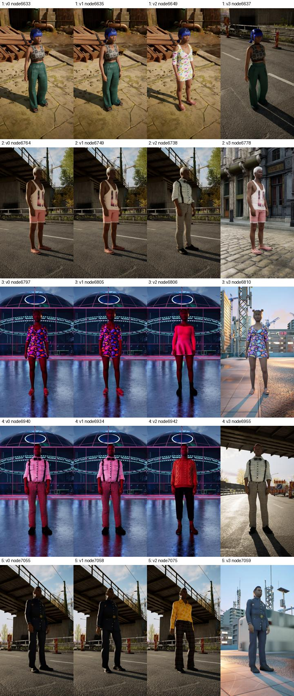

# 五条竖屏展示候选

## 2026-11-15：已构造，未运行模型

统一结构：视频0（原始）→视频1（只换动作）→视频2（在视频1上换整套服装）；视频0→视频3（只换场景）。第三轮回到原视频，因此沿用原动作和原服装。

全部从正式test.jsonl的合法编辑关系组合，不沿用原有整链；未修改正式100条测试名单。136种可用组合来自33个竖屏起点，本次选择五个不同人物，优先全身或前方镜头及整套服装变化。

七个属性来自节点与资产目录；服装中文外观简述结合视频关键帧。发色按资产设定记录，灯光会影响画面颜色。本次检查关键帧和媒体规格，未做模型推理或完整动作质量评审。

## 候选1：节点6633 → 6635 → 6649 → 6637

上面的编号按视频0、1、2、3排列；视频3的父节点是视频0。

| 初始属性 | 内容 |
|---|---|
| 人物 | 女性，ID 15（CFD40_BF_005） |
| 发型 | 低位双丸子头 |
| 发色 | 蓝色 |
| 服装 | 花纹无袖短上衣＋绿色长裤＋凉鞋 |
| 动作 | 向前行走 |
| 镜头 | 俯视全身 |
| 场景 | 海滨小镇 |

1. 动作：向前行走 → 举拳庆祝
2. 服装：花纹无袖短上衣＋绿色长裤＋凉鞋 → 浅色花卉露肩短裙＋鞋
3. 回到视频0，场景：海滨小镇 → 傍晚公路；保留原动作“向前行走”与原服装

编辑边：26332, 26349, 26334

## 候选2：节点6764 → 6749 → 6738 → 6778

上面的编号按视频0、1、2、3排列；视频3的父节点是视频0。

| 初始属性 | 内容 |
|---|---|
| 人物 | 男性，ID 18（CFD40_BM_003） |
| 发型 | 后梳短发 |
| 发色 | 白色 |
| 服装 | 白色印花背心＋粉色短裤＋休闲鞋 |
| 动作 | 思考 |
| 镜头 | 前侧全身 |
| 场景 | 傍晚公路 |

1. 动作：思考 → 举拳庆祝
2. 服装：白色印花背心＋粉色短裤＋休闲鞋 → 浅色衬衫＋背带格纹长裤＋皮鞋
3. 回到视频0，场景：傍晚公路 → 维多利亚街道；保留原动作“思考”与原服装

编辑边：28344, 28262, 28348

## 候选3：节点6797 → 6805 → 6806 → 6810

上面的编号按视频0、1、2、3排列；视频3的父节点是视频0。

| 初始属性 | 内容 |
|---|---|
| 人物 | 女性，ID 13（CFD40_BF_003） |
| 发型 | 高位双丸子头 |
| 发色 | 栗色 |
| 服装 | 彩色图案露肩短裙＋低帮鞋 |
| 动作 | 向前行走 |
| 镜头 | 正面全身 |
| 场景 | 未来都市 |

1. 动作：向前行走 → 扶额
2. 服装：彩色图案露肩短裙＋低帮鞋 → 上衣＋短裙＋靴子（图中为红色调）
3. 回到视频0，场景：未来都市 → 日本城市街区；保留原动作“向前行走”与原服装

编辑边：28477, 28528, 28478

## 候选4：节点6940 → 6934 → 6942 → 6955

上面的编号按视频0、1、2、3排列；视频3的父节点是视频0。

| 初始属性 | 内容 |
|---|---|
| 人物 | 男性，ID 17（CFD40_BM_002） |
| 发型 | 武士式顶髻 |
| 发色 | 红色 |
| 服装 | 浅色衬衫＋背带格纹长裤＋皮鞋 |
| 动作 | 思考 |
| 镜头 | 正面推进 |
| 场景 | 未来都市 |

1. 动作：思考 → 举拳庆祝
2. 服装：浅色衬衫＋背带格纹长裤＋皮鞋 → 红色针织上衣＋深色长裤＋靴子
3. 回到视频0，场景：未来都市 → 傍晚公路；保留原动作“思考”与原服装

编辑边：29808, 29774, 29811

## 候选5：节点7055 → 7058 → 7075 → 7059

上面的编号按视频0、1、2、3排列；视频3的父节点是视频0。

| 初始属性 | 内容 |
|---|---|
| 人物 | 男性，ID 20（CFD40_BM_005） |
| 发型 | 顶髻长马尾 |
| 发色 | 黑色 |
| 服装 | 深色警服套装＋皮鞋 |
| 动作 | 打喷嚏 |
| 镜头 | 仰视全身 |
| 场景 | 傍晚公路 |

1. 动作：打喷嚏 → 向前行走
2. 服装：深色警服套装＋皮鞋 → 黄色花纹衬衫＋格纹长裤＋鞋
3. 回到视频0，场景：傍晚公路 → 日本城市街区；保留原动作“打喷嚏”与原服装

编辑边：30301, 30324, 30302

